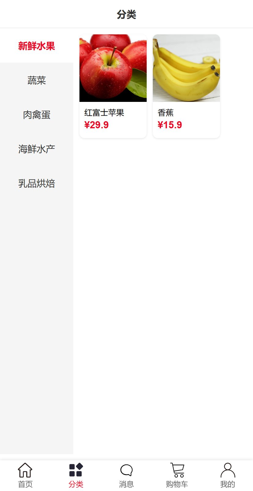
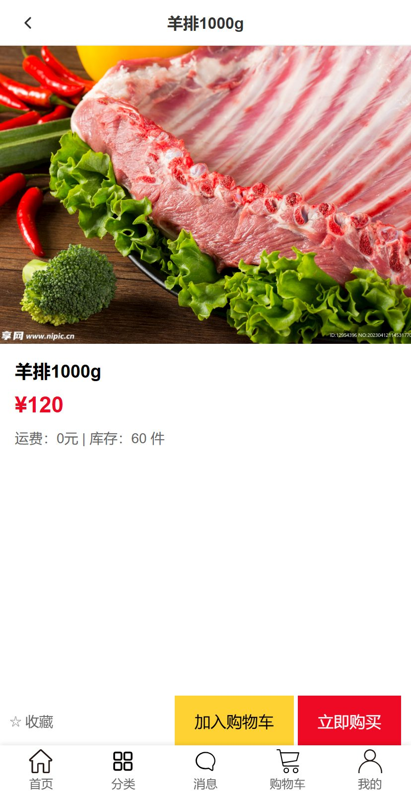
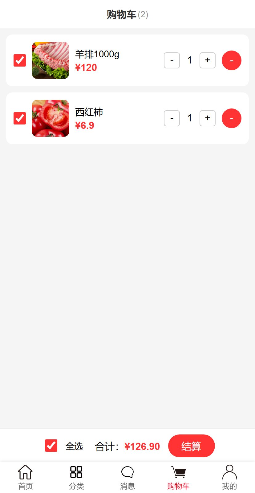
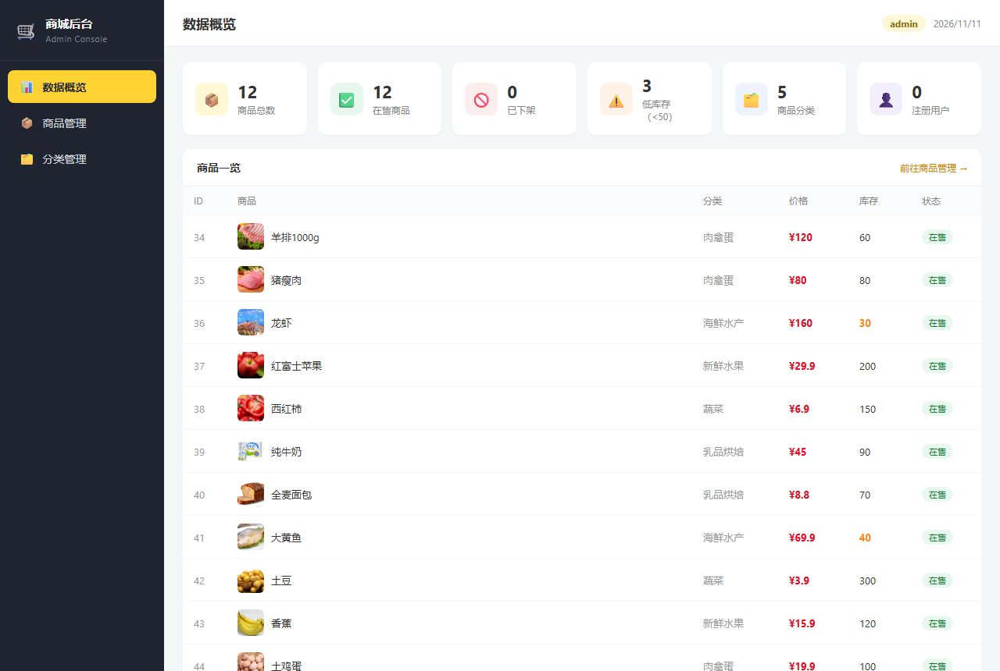
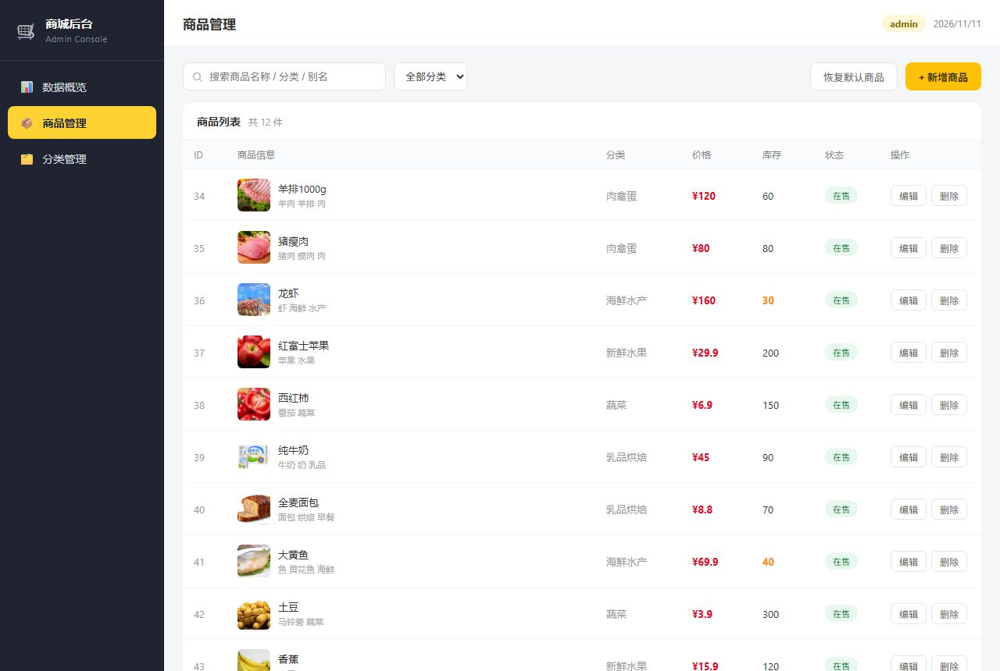

# 生鲜商城

Vue 3 前端 + Spring Boot 后端的课程实训项目。前台是手机端商城（首页 / 分类 / 详情 / 购物车 / 我的），
后台是商品管理系统（登录 / 数据概览 / 商品管理 / 分类统计）。

## 界面预览

<p align="center">
  
  
  
  
</p>
<p align="center"><sub>前台商城 · 首页 / 分类 / 商品详情 / 购物车</sub></p>

<p align="center">
  
  
</p>
<p align="center"><sub>后台管理（独立入口 /admin/）· 数据概览 / 商品管理</sub></p>

## 功能清单

**前台商城**

| 模块 | 功能 |
|---|---|
| 首页 | 关键词搜索、分类快捷入口、轮播图、在售商品瀑布流 |
| 分类 | 左侧 5 个分类切换，右侧商品列表，带分类参数跳转 |
| 商品详情 | 图片价格库存展示、收藏、加入购物车、立即购买 |
| 购物车 | 单选/全选、数量加减、删除、实时合计、选择收货地址结算 |
| 消息 | 下单后自动生成订单消息、未读角标 |
| 我的 | 登录注册、订单列表/详情、收藏、地址管理、账号设置 |

**后台管理**

| 模块 | 功能 |
|---|---|
| 登录 | 账号密码校验，签发令牌，路由守卫拦截未登录访问 |
| 数据概览 | 商品总数、在售/下架、库存告警、分类分布等 6 项统计 |
| 商品管理 | 搜索筛选、新增/编辑/删除、上下架、图片选择、恢复默认 |
| 分类统计 | 5 个分类的商品数与库存明细 |

**服务端**

商品 CRUD、分类白名单校验、重名校验、价格精度处理（BigDecimal）、
局部更新、统一错误响应、HMAC 令牌鉴权、初始数据自动灌入。

## 技术栈

| 层 | 技术 |
|---|---|
| 前端 | Vue 3（`<script setup>`）、Vue Router 4、Vuex 4、Vant 4、Vite 8 |
| 后端 | Spring Boot 3.4.5、Spring MVC、Spring Data JPA、Bean Validation |
| 数据库 | H2（文件模式，免安装）、JPA 自动建表 |
| 鉴权 | 自签 HMAC-SHA256 令牌 + 拦截器 |

## 目录结构

```
Shixun/
├─ index.html           前台入口  → 访问 /
├─ admin/index.html     后台入口  → 访问 /admin/（独立应用）
├─ src/                 前台源码
│  ├─ api/http.js       统一请求封装（带令牌、统一错误处理）
│  ├─ data/goods.js     商品数据层：接口客户端 + 内存缓存（前后台共用）
│  ├─ views/            前台页面（home / category / cart / message / mine）
│  ├─ components/       详情、订单、收藏、地址等公共页
│  └─ router/index.js   前台路由（不含任何后台页面）
├─ src/admin-app/       后台源码（独立应用，与前台上台无关）
│  ├─ main.js           后台入口脚本
│  ├─ router.js         后台路由（hash 模式）
│  └─ views/            登录 / 概览 / 商品管理 / 分类统计
└─ server/              Spring Boot 后端
   ├─ src/main/java/com/cjy/shop
   │  ├─ domain/        实体 Goods + Repository
   │  ├─ service/       业务逻辑 + 初始数据
   │  ├─ web/           Controller + 请求/响应 DTO
   │  ├─ security/      令牌签发校验 + 鉴权拦截器
   │  ├─ config/        跨域、拦截器注册、启动灌数据
   │  └─ common/        统一异常与错误响应
   └─ src/main/resources/application.yml
```

## 启动方式

需要 JDK 17+、Maven 3.6+、Node 18+。

### 1. 后端（先启动）

```bash
cd server
mvn spring-boot:run
# 或者打包后运行
mvn clean package -DskipTests
java -jar target/shop-server-1.0.0.jar
```

启动成功后：

- 接口根路径 <http://localhost:8090/api>
- H2 控制台 <http://localhost:8090/h2-console>
  （JDBC URL 填 `jdbc:h2:file:./data/shopdb;MODE=MySQL`，用户名 `sa`，密码留空）

> 端口是 **8090**，因为 8080 常被其他项目占用。要改端口就改 `server/src/main/resources/application.yml` 的 `server.port`，
> 同时把 `vite.config.js` 里的 `BACKEND_URL` 一起改掉。

### 2. 前端（两个独立入口）

```bash
npm install
npm run dev
```

| 端 | 地址 | 说明 |
|---|---|---|
| 前台商城 | <http://localhost:5180/> | 手机端商城，游客可直接浏览 |
| 后台管理 | <http://localhost:5180/admin/> | 独立应用，需登录 |

前端通过 Vite 代理把 `/api` 转发到 `http://localhost:8090`，所以浏览器里是同源请求，不会有跨域问题。

### 3. 后台登录

直接打开 <http://localhost:5180/admin/> 即进入登录页（前台「我的」页面已不再放后台入口）。

账号 `admin`，密码 `admin123`（配置在 `application.yml` 的 `shop.admin.*`）。

## 接口一览

| 方法 | 路径 | 说明 | 需要令牌 |
|---|---|---|---|
| POST | `/api/auth/login` | 管理员登录，返回 token | 否 |
| GET | `/api/goods` | 商品列表，支持 `keyword` / `category` / `onSale` 过滤 | 否 |
| GET | `/api/goods/{id}` | 商品详情 | 否 |
| POST | `/api/goods` | 新增商品 | 是 |
| PUT | `/api/goods/{id}` | 修改商品（只传要改的字段） | 是 |
| DELETE | `/api/goods/{id}` | 删除商品 | 是 |
| POST | `/api/goods/reset` | 恢复默认 12 件商品 | 是 |

写操作请求头需要带 `Authorization: Bearer <token>`。查询接口对前台开放，游客也能浏览商城。

## 几点设计说明

**为什么数据库用 H2 而不是 MySQL。** H2 文件模式不用安装数据库服务，交作业或换台电脑 clone 下来就能跑。
SQL 方言配了 `MODE=MySQL`，将来换 MySQL 只需改 `application.yml` 的 datasource 和 pom 里的驱动依赖。

**为什么前端要把商品数据收敛到 `src/data/goods.js`。** 最初三个页面各存一份商品数组，后台改了前台不动。
后来统一成一个数据源：现在它是「接口客户端 + 内存缓存」，对外暴露的 `allGoods`、`categories`、`goodsStats`
仍然是 computed，页面代码一行没改就从 localStorage 切到了服务端数据。

**为什么后台要做成独立入口。** 最初后台是前台 SPA 里的一组 `/admin/*` 路由，入口藏在「我的」页面里。
这样有两个问题：前台的包里塞进了后台的全部代码（且登录页的号密校验能被绕过），
后台的路由守卫也会和前台 Tabbar、返回键等逻辑互相干扰。
现在拆成两个 HTML 入口（`index.html` 与 `admin/index.html`），构建产物是 `dist/index.html` 和 `dist/admin/index.html`，
前台包 104KB、后台包 19KB，互不包含；后台用 hash 路由，刷新任意后台页面都不会 404。

**为什么令牌不用 Spring Security。** 只有一个管理员账号、一个写权限边界，引入完整 Security 反而重。
这里用 30 行 HMAC 签名实现无状态令牌：服务重启后旧 token 仍可校验通过，直到过期。

**已知边界。** 用户注册/登录（`users`、`loginUser`）、购物车、订单仍存在浏览器 localStorage，
不跨设备也不同步；商品数据已经走后端数据库，是真正持久化的。
